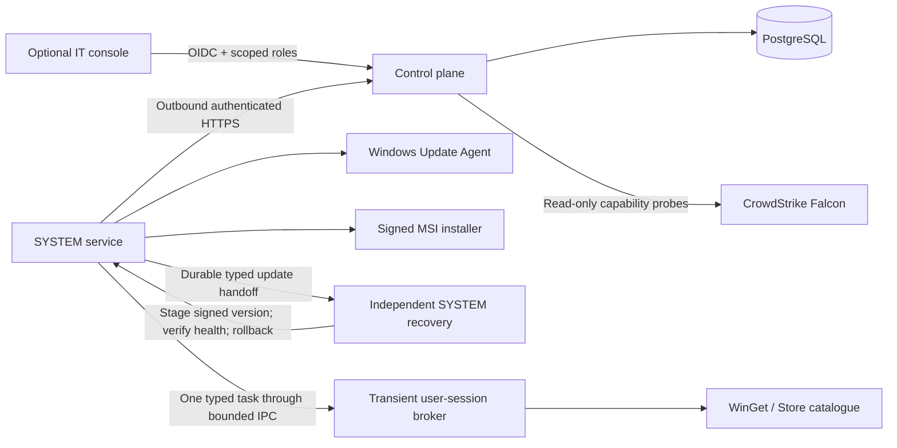

# Architecture and trust boundaries

Imported and adapted design guidance. See [development status](development-status.md) for current boundaries. Source-era pilot observations are historical evidence and do not establish current deployment or endpoint acceptance.

The control plane is a TypeScript/Fastify service backed by PostgreSQL. The endpoint installer contains the Go bootstrap, which manages enrollment, authenticated transport and selected module lifecycles. Its Windows service runs as LocalSystem. Feature engines download separately from the server's catalog. The imported .NET 10 service and providers remain a compatibility foundation during extraction. The IT console is a separately built React application; neither the API nor the bootstrap depends on it.

## Independent modules

| Module | Identity / privilege | Can be omitted? |
| --- | --- | --- |
| `apps/control-plane` | Server process; PostgreSQL application role | Required |
| `native/cmd/oc-bootstrap` | LocalSystem on Windows; outbound connections | Required on managed endpoints |
| `modules/<feature>/native` | Privilege and scope declared by the signed package | Download only when selected |
| `agent/OneControl.Agent.Service` | Imported compatibility service | Migration input; excluded from thin installation |
| `modules/bootstrap-update/windows` | Independent recovery/update compatibility providers | Separate native extraction and acceptance required |
| `modules/user-session-host/windows` | Selected user session; no fleet credential | Needed only by selected user-scoped features |
| `apps/console` | OIDC operator, approver, or viewer | Completely optional; independently hosted |

The broker has no GUI and does not persist as a user-facing agent. WinGet/Store operations use an interactive user's package registration and permissions; they are not run with an improvised SYSTEM WinGet path. An active console user takes precedence. When no console user is logged in, a single active RDP user is eligible. Multiple active RDP users without a console user are ambiguous and require an explicit future targeting policy; the agent does not choose one implicitly.

## Coordination and recovery

An enrollment token has 256 bits of entropy, a 15-minute expiry, and one atomic use. Fleet credentials have separate hashes, a 90-day expiry, revocation, and overlapping rotation. The service protects the credential using Windows DPAPI. Installation restricts ordinary users' access to configuration and state.

Administrator tokens use a configured OIDC issuer, audience, algorithm allowlist, expiry and issue time. Subject allowlists determine operator, approver and viewer roles. The operator cannot approve their own installation batch. Development uses three independent role secrets, binds only to loopback, and is rejected in production.

Each operation snapshots explicit devices and a rollout ring. One PostgreSQL transaction creates its jobs and audit event. An idempotency key scoped to the operator prevents duplicate batch creation. Canary must finish successfully before the identical command can enter pilot; pilot must succeed before broad. Maintenance windows gate dispatch and installer start; an installation already running may finish outside its start window.

PostgreSQL row locks and a partial unique index permit one active lease per device, across system and user-context jobs. A random fencing token and bounded lease control renewal and terminal receipts. The Windows SQLite journal records execution before side effects and retains unacknowledged results across service restarts. Inventory scans may retry up to three lease attempts. A mutation with an expired lease becomes `indeterminate`, and its device cannot claim new work until IT reconciles the outcome with evidence. Cancellation removes pending work; it does not pretend to reverse an installer already running.

Audit entries accompany administrative changes and lifecycle transitions in the same database transaction. This is an application audit trail, not a claim of cryptographic tamper evidence against a database administrator. Production must grant the runtime INSERT/SELECT access only to the audit table and export to a separately controlled retention destination.

Agent replacement is handed to a separate signed SYSTEM recovery process using a private, atomically written record. The recovery service owns lease renewal and the terminal receipt after handoff. A stage-only signed MSI writes an immutable version directory without custom actions or service operations. Recovery preserves the former executable's hash and broker path before installation, then switches the service only after validating the candidate signature and version. Success requires a fresh authenticated heartbeat from that exact executable, version, device and service PID. An unhealthy candidate is rolled back to the retained previous bytes. Interruption during MSI execution remains indeterminate because Windows Installer may continue after its caller exits; the recovery host never starts that installation again. Its own binary remains outside the version payload and requires separate IT-controlled deployment and acceptance.

## Update trust

Custom MSI releases require a signed metadata envelope verified by both server and agent. RSA-PSS/SHA-256 signs the exact payload bytes with a minimum 3072-bit offline key. Metadata binds package identity, increasing sequence, version, expiry, artifact URL, exact size, SHA-256 and Authenticode publisher thumbprint. The agent also checks its local package allowlist, rejects redirects and unapproved origins, enforces size while streaming, verifies Windows Authenticode trust and publisher identity, and stores its highest attempted release sequence durably. Reissue failed custom releases with a new sequence.

This scoped release format is not a full TUF implementation. Threshold signing, root-key rotation, snapshot/timestamp roles, and emergency rollback authorization remain explicit future work. No unsigned custom installer, unbounded download, arbitrary remote shell, hash-bypass flag, forced reboot or Falcon exclusion action is exposed.

## Visibility and administrative control

The service is quiet during normal operation, runs without a user-facing window, and has no tray integration. The optional console is only distributed to authorised staff. A privileged Windows administrator can enumerate services/processes, read privileged state, stop services, or take ownership. This product does not hide processes, modify kernel visibility, interfere with security software, or claim protection against an administrator who controls the OS.

## Deployment shape

Begin with one API and PostgreSQL. Add API replicas behind TLS ingress when needed; device locks and leases remain in PostgreSQL. There is no Redis dependency or in-memory job queue. PGlite provides local development and isolated tests only; real PostgreSQL tests also run in CI. Production startup refuses PGlite, requires OIDC and update trust configuration, and applies no implicit schema migration. Run migrations once with the dedicated migration identity before deploying API replicas.

TLS ingress and database access must be private to the deployment network; the API trusts neither caller-supplied forwarded identity nor proxy authentication headers. TLS ends at the trusted ingress. Deployments need backups with tested restoration, availability/error metrics, job-age alerts, secret management, container digest pinning, and a real-company-Windows acceptance pilot before fleet rollout.
